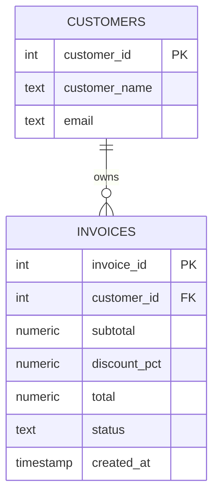

# Demo data model

All data is generated locally using `generate_series`; no personal data, customer
exports, or downloaded datasets are required.

The seeded environment has **50,000 customers** and **1,000,000 invoices**. Most
invoices are pre-finalized using the correct arithmetic. Four named invoice IDs
(1001–1004) are reserved as drafts for a focused debugging walkthrough.

A table-level CHECK constraint independently enforces nonnegative totals and
consistency between status and total. A separate `BEFORE INSERT OR UPDATE` trigger
also validates finalized totals to demonstrate trigger debugging and produce a
specific exception message.

The data generation is deterministic; disk usage and runtime depend on your server.
